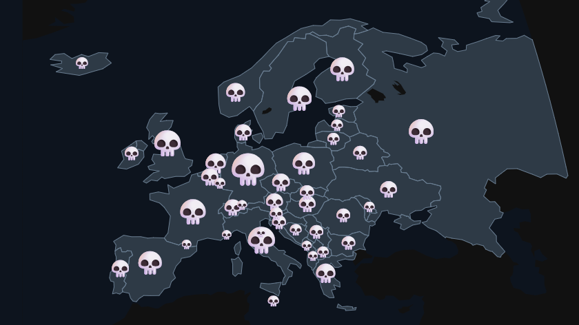
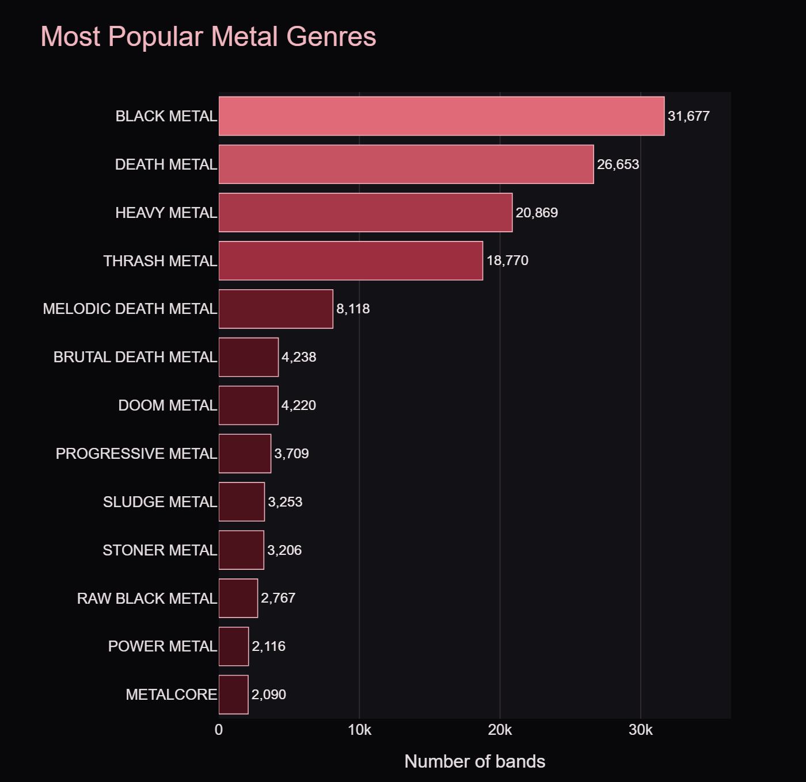

# Metal Bands in Europe and Worldwide

This project explores the geographic distribution of metal bands and the popularity of metal genres. It was created to practice data analysis and visualization, with a dark, metal-inspired style and a playful skull-emoji map.

## Notebooks

1. [`01_METAL_BANDS_EUROPE.ipynb`](./notebooks/01_METAL_BANDS_EUROPE.ipynb) counts bands by country and visualizes their distribution across Europe.
2. 

1. [`02_METAL_GENRES.ipynb`](./notebooks/02_METAL_GENRES.ipynb) cleans and groups genre labels, compares overall genre totals, and presents separate top-10 genre charts for each continent. It also exports all seven charts as PNG files to [`visualization/`](./visualization/).

